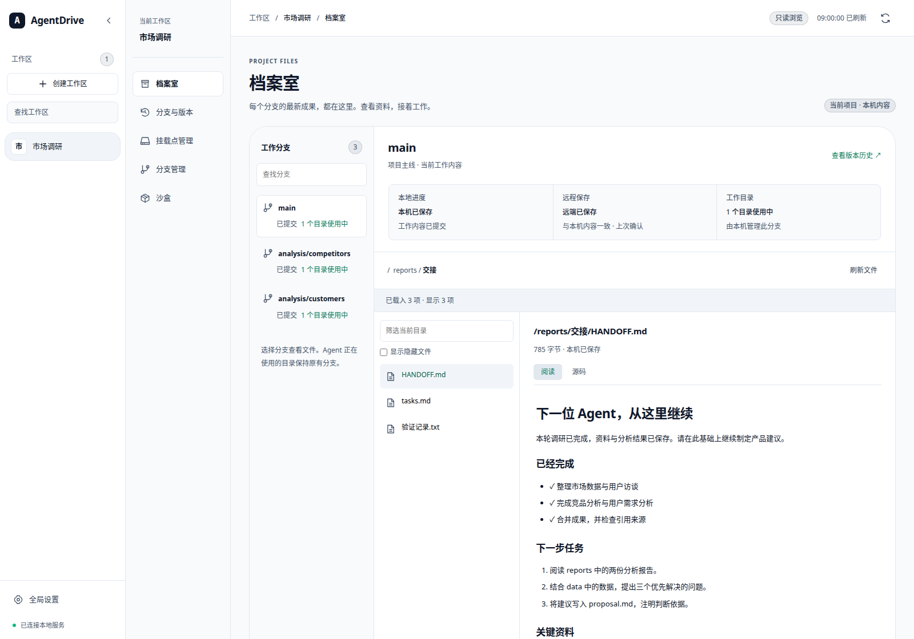
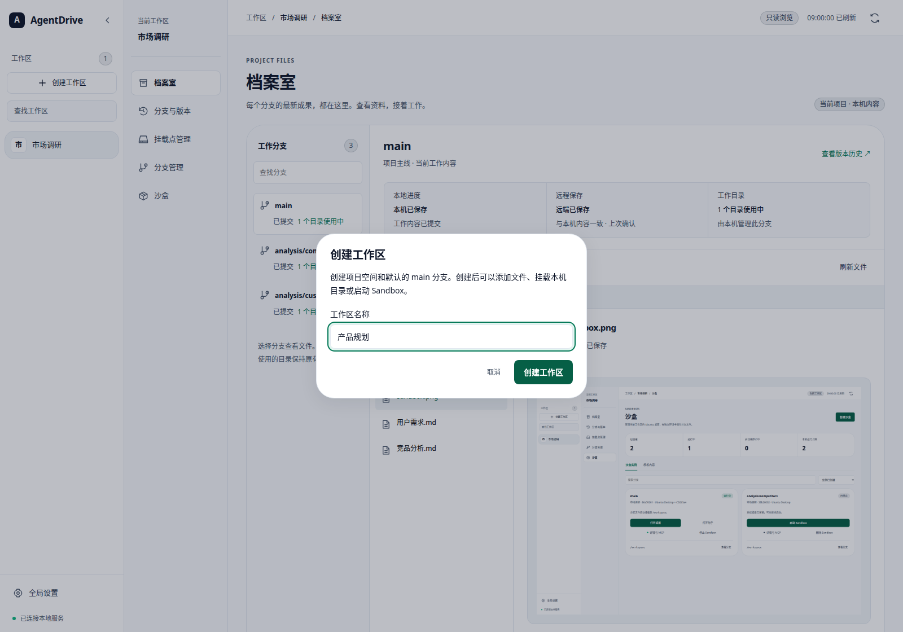
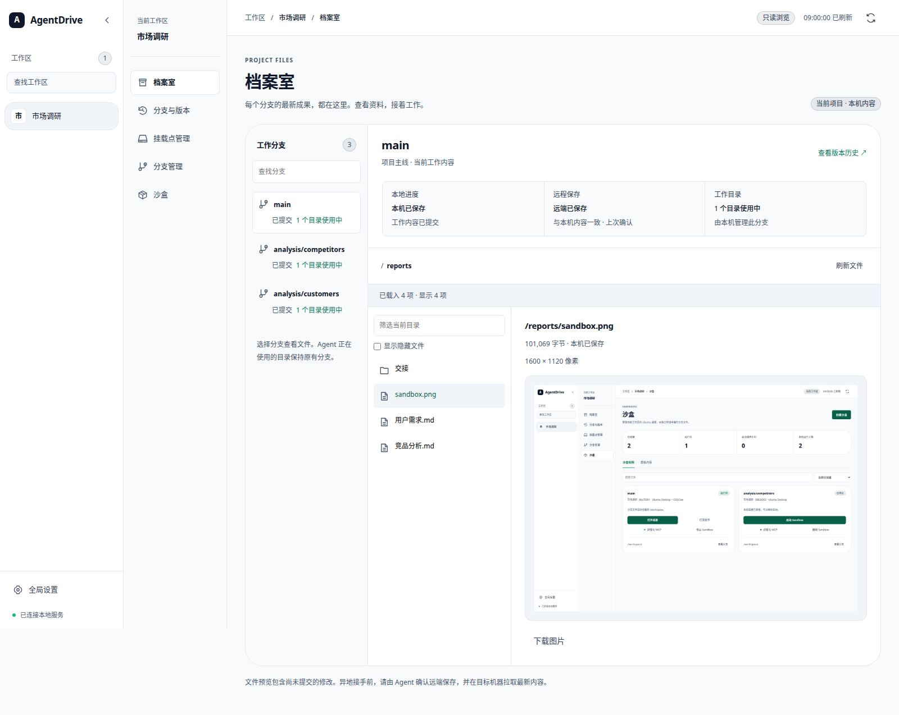
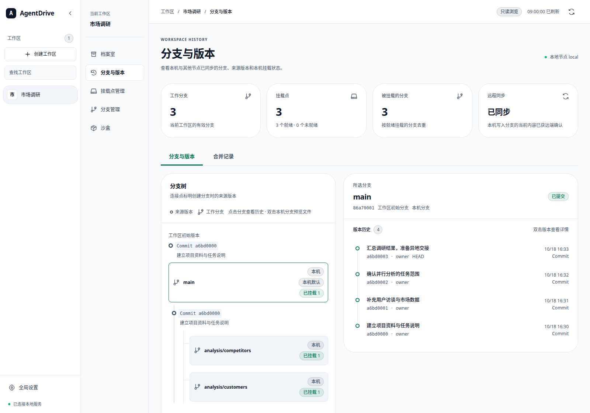
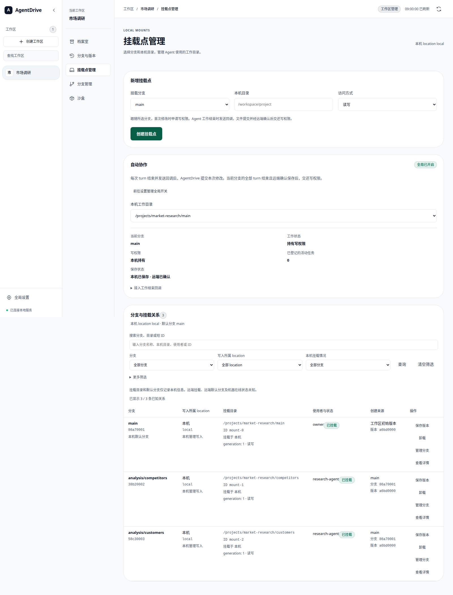
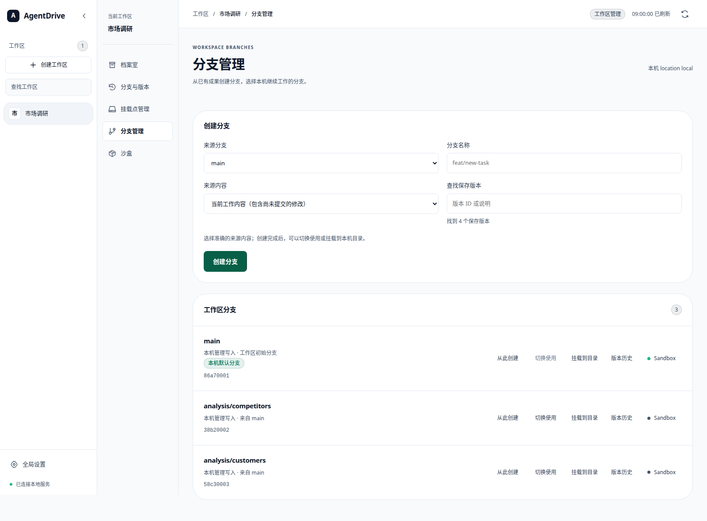
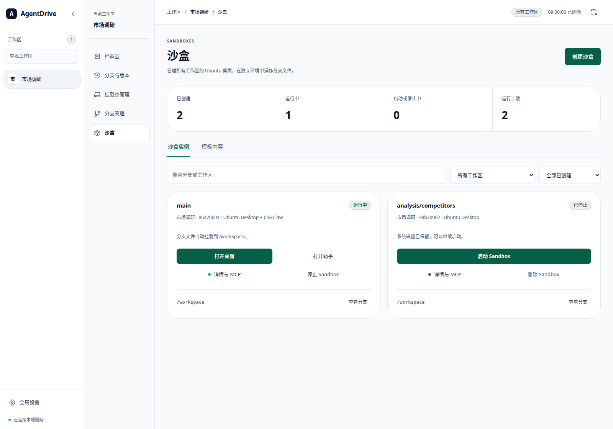
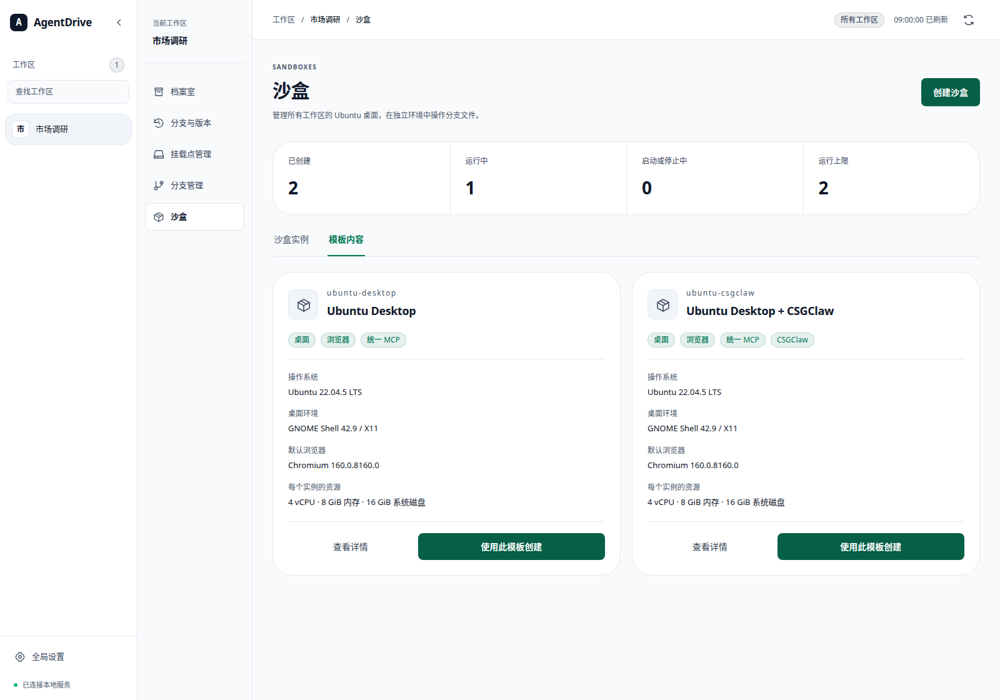

# AgentDrive

[English](README.md) | [简体中文](README.zh-CN.md)

**Share the files. Pick up the work.**

AgentDrive gives people and agents a persistent project space. Agents read source material, write documents and edit code in a local directory. Their work can be saved remotely so an agent on another machine can continue. Branches keep parallel tasks separate, and versions record how the results evolve.

Keep using your preferred agent, editor and terminal. MCP lets agents manage saving, synchronization, branches and handoffs. People can open the **Archive** to read documents and preview images in each branch. On a configured Linux host, each branch can also have an Ubuntu desktop Sandbox with a shared browser and an optional CSGClaw assistant.

> Development preview; the first formal release has not shipped. AgentDrive is the current product name.



*Demo project: market research. Read the agent handoff in `/reports/交接` alongside local save state and remote confirmation. The current dashboard is in Chinese.*

## Keep the project moving

| When you need to… | AgentDrive helps you… |
| --- | --- |
| Work locally and save remotely | Use ordinary file tools, keep local work, and synchronize results through configured S3 / RustFS or OpenCSG Codes storage. |
| Hand work to an agent elsewhere | Save the brief, input files, results and next steps together; pull them on the receiving machine. |
| Try several approaches in parallel | Branch from shared material, complete separate tasks, review changes and merge the results. |
| Check progress yourself | Browse documents and images in the Archive, then inspect their origins and changes in Branches & Versions. |
| Give an agent a desktop | Start a branch Sandbox, connect its unified MCP, and operate Chromium and desktop apps against the same branch files. |

## How to use it

### 1. Connect a local project and start working

Follow [installation and startup](docs/installation.md), then connect AgentDrive to an MCP-capable agent client. An existing local directory can be imported and mounted back at the same path. Pause writes before converting it, and restart the agent after conversion.

To start an empty project in the dashboard, click **Create Workspace** in the left sidebar and enter a name. AgentDrive creates the workspace and its default `main` branch, then opens the Archive. From there, use Mount Management to attach a local directory or create a branch Sandbox.



Ask your agent:

> Connect this project to AgentDrive. Keep its existing files, create a branch for this task, and tell me the working directory and branch name.

The agent creates, mounts or adopts a workspace through MCP, then continues using its normal file tools. Changes are automatically saved. Ask it to save a named version when you reach a meaningful milestone.

### 2. Synchronize local results to remote storage

Choose storage when creating a workspace, or select an existing workspace under **Settings → Configuration scope**. Use local storage, S3-compatible storage (including OSS and RustFS), or OpenCSG Codes. For a Codes repository with XNet enabled, select XNet to use the repository’s large-file rules. Collaborating machines use the same destination for the workspace and keep independent local state. [Connection guide](docs/configuration.md)

> Save this branch remotely. After remote publication is confirmed, report the workspace ID, branch, version and handoff document path.

The agent can request remote durability with `mount_save` and inspect `remote_confirmed` in the operation receipt. If waiting times out, keep polling the same operation. **Local saving and remote confirmation are separate states.** The Archive reports the latest known remote confirmation.

### 3. Let an agent on another machine continue

Keep a `HANDOFF.md` in the project with the goal, completed work, important files, validation steps and remaining tasks. Save it remotely with the results.

Give the receiving agent the workspace ID, source branch or revision and handoff path:

> Pull the latest confirmed remote project data, read HANDOFF.md, create my branch from the specified source, mount it locally and continue the next task.

The receiving agent uses `sync`, creates a branch from the intended source and mounts it. To continue writing **the same branch**, stop writes and release mounts on the previous machine, transfer write ownership with `ownership_transfer`, then pull and confirm adoption at the destination location. [Handoff and recovery](docs/operations.md)

Handoffs carry files, versions and branch information. Task context can travel as project documents. Running processes, chat history and client credentials are managed by each agent client.

### 4. Read results in the Archive and inspect changes in history

Open the dashboard, select a project and enter **Archive**:

- Select a branch to browse its current directory; a file preview opens automatically.
- Read Markdown as a document or source. Preview PNG, JPEG, GIF, WebP, BMP, AVIF and ICO images up to 20 MiB and download the original file. Page through text and inspect other binary files in hexadecimal.
- Click any segment of the `/a/b/c` directory path to navigate. Filter the current directory, reveal hidden files and return to the same project, branch and directory through its URL.
- See local progress, remote confirmation and directory usage separately. Browsing leaves the agent's mounted branch unchanged.
- Files reflect locally known current contents, including unsaved or uncommitted edits. Ask the agent to pull remote updates before reviewing new work from another machine.





*The same demo project in Branches & Versions. Double-click a revision to inspect its metadata, changed files and text differences.*

### 5. Manage mounts and branches

Use **Mount Management** (`/mounts`) to attach a branch to a local directory, save its contents or unmount it. Search and filter branch relationships by directory, branch, writer location and mount status. Filters stay in the page URL.

Use **Branch Management** (`/branches`) to create a branch from current local work or a saved revision, choose the local default branch, mount a directory or inspect version history.





### 6. Run a desktop and assistant for a branch

With the [Sandbox runtime configured](docs/sandbox.md), open **Sandboxes** (`/sandboxes`) or the **Sandbox** button beside a branch. Select a writable local branch and a template, then create and start the instance. The catalog lists only the current workspace’s instances, with state and branch-name filters. Templates are shared by all workspaces; the running-instance limit applies to the whole host.

- **Ubuntu Desktop** includes GNOME, Chromium, Chinese and emoji fonts, a terminal, file manager and image viewer.
- **Ubuntu Desktop + CSGClaw** adds the CSGClaw Web UI and Agent. **Open Assistant** opens the Web UI directly through AgentDrive; VNC login is unnecessary. Configure the model account in CSGClaw, then chat to operate files and the browser.
- The selected branch is mounted at `/workspace`. Browser downloads go to `/workspace/Downloads`. Each instance stays attached to its original branch.
- **Details & MCP** shows startup progress, proxy settings and one copyable MCP configuration. computer-use-linux and Playwright MCP share the Chromium shown in the desktop. This Sandbox connection provides desktop and browser tools; the AgentDrive MCP below manages project data.
- Stop an instance to release its running resources and keep its system disk. Delete a stopped instance to remove that disk while retaining branch files and version history. Updating a template applies to newly created instances.





*Screenshots use reproducible demonstration data rendered by the current dashboard. Template details open in a dialog beside the create action.*

The desktop runtime requires Linux x86_64, FUSE and an available KVM or PVM device with a compatible guest kernel. AgentDrive detects the host backend and selects a configured matching kernel on startup. Default instance resources are 4 vCPU, 8 GiB memory and a 16 GiB sparse system disk. Docker is used to build templates; instances run through the worker and included hypervisor. Build scripts, networking, kernel configuration and MCP connection requirements are documented in the [Sandbox guide](docs/sandbox.md) (Chinese).

## Built for agents to operate

For a client that supports stdio MCP, add this configuration and replace the example paths with local absolute paths:

```json
{
  "mcpServers": {
    "agentdrive": {
      "command": "/absolute/path/agentdrive/target/debug/agentdrive",
      "args": ["mcp"],
      "env": {
        "AGENTDRIVE_ENDPOINT": "http://127.0.0.1:7421/mcp"
      }
    }
  }
}
```

Keep the AgentDrive service running. Agents can discover tool schemas and manage workspaces, branches, saves, synchronization and handoffs. Streamable HTTP clients can connect to `http://127.0.0.1:7421/mcp` without a token. CLI commands support terminal workflows and scripts; ACP / Codex app-server integrations connect working directories with end-of-task saving. [Agent integrations](docs/integrations.md) · [MCP tools](docs/mcp.md) · [CLI](docs/cli.md)

A single `branch_switch` call completes a branch change. If a process occupies the directory, follow the response instructions to close it or restart the agent, then retry the same operation.

## Get started

Build from source on Linux, macOS or Windows. Linux mounts use FUSE, macOS uses its built-in NFS client, and Windows uses WinFsp. [Installation, dependencies and startup commands](docs/installation.md)

- [Remote storage configuration](docs/configuration.md): local storage, S3, RustFS, OpenCSG Codes and multiple machines.
- [Operations and recovery](docs/operations.md): publication confirmation, handoffs, merging and recovery.
- [Documentation index](docs/README.md): complete usage references and developer documentation.

AgentDrive is licensed under Apache-2.0. Included components retain their licenses, including the WinFsp Rust wrapper (MIT) and the CubeSandbox-derived hypervisor under `sandbox/hypervisor`. Template software has its own license terms and source records.
