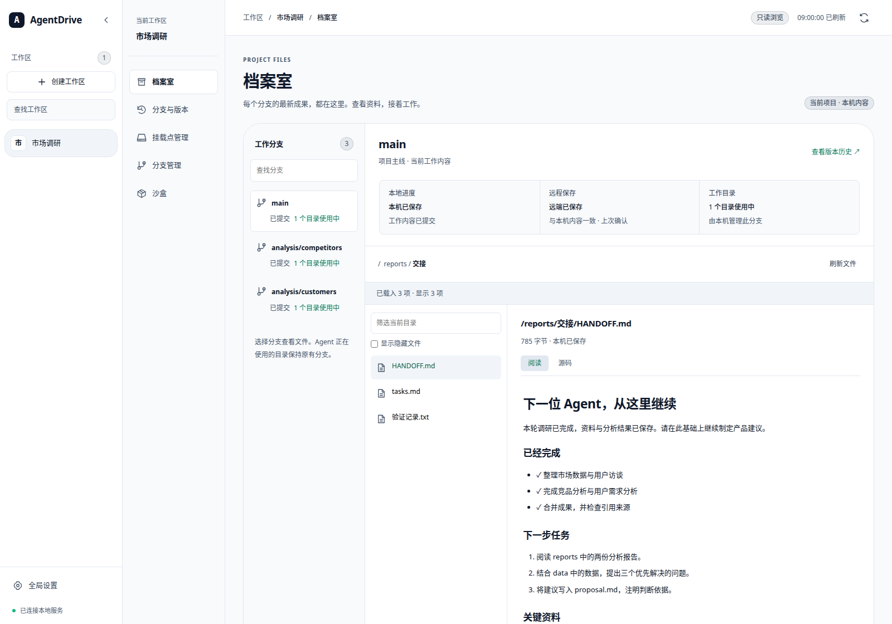
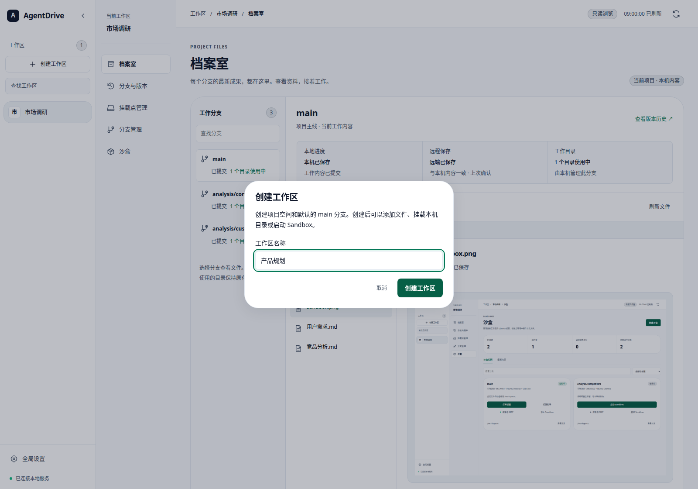
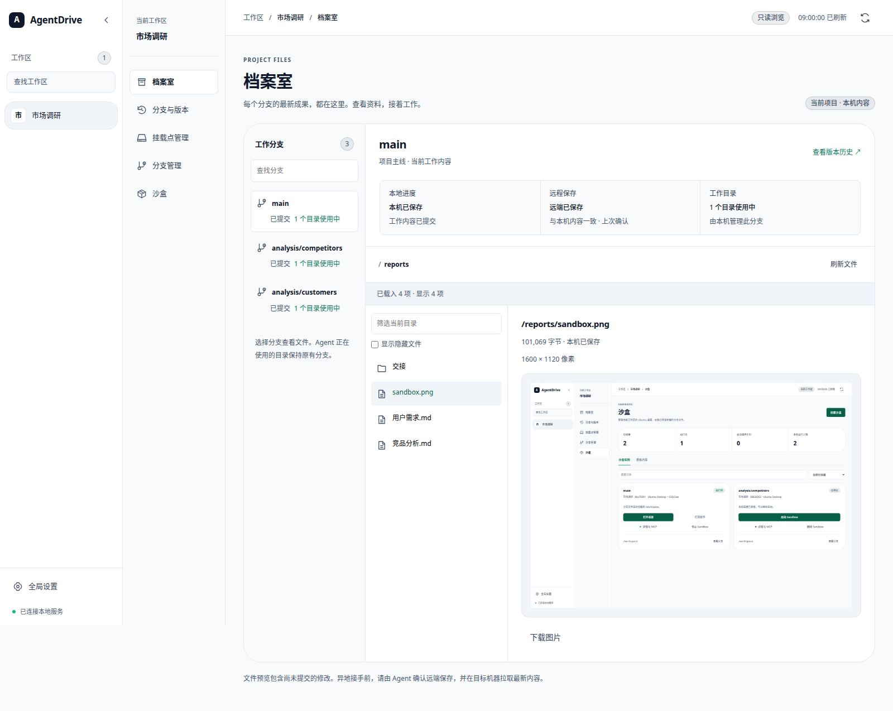
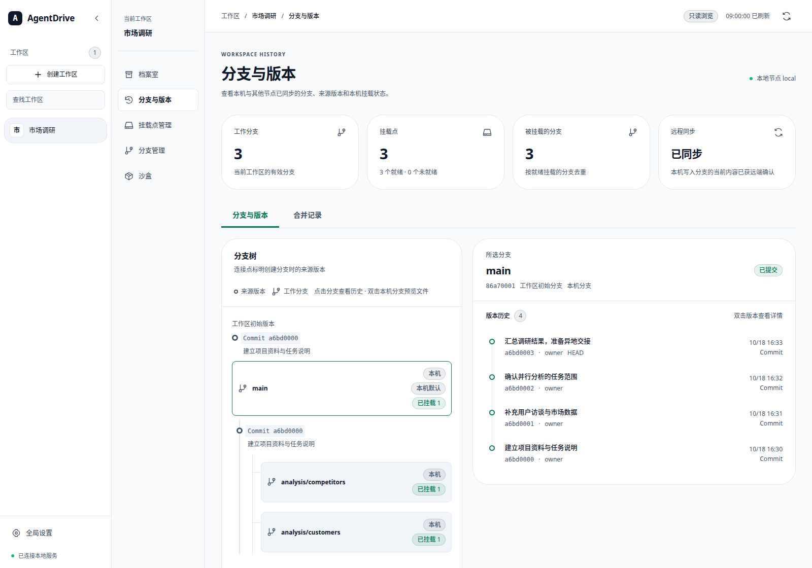
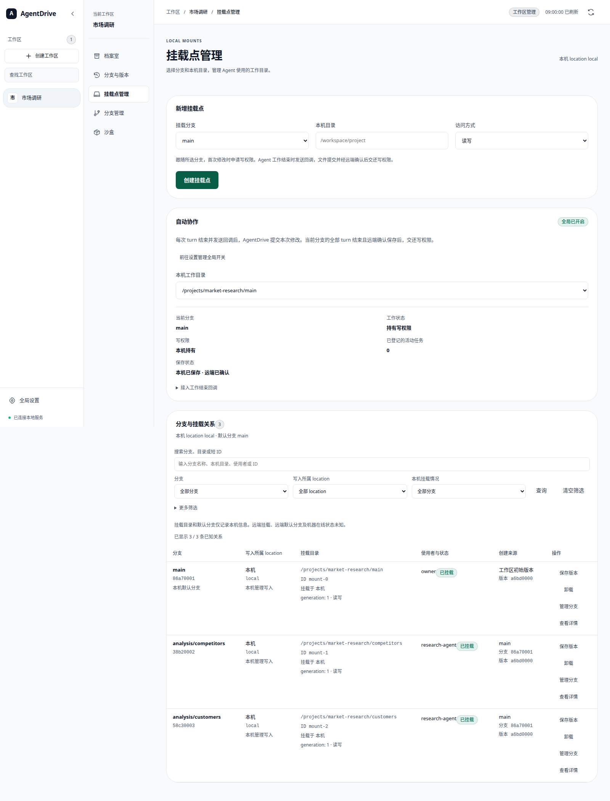
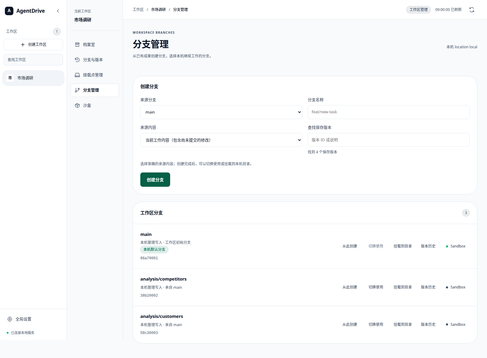
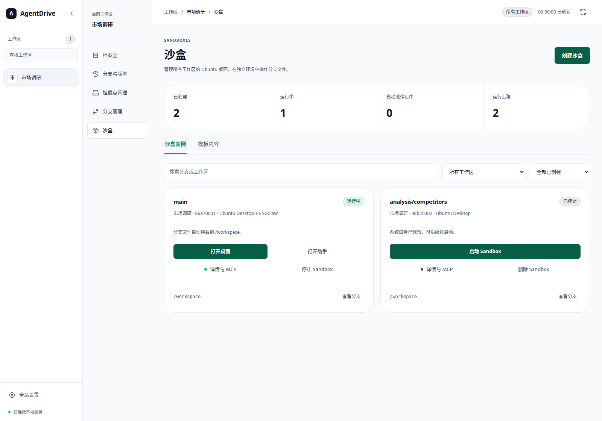
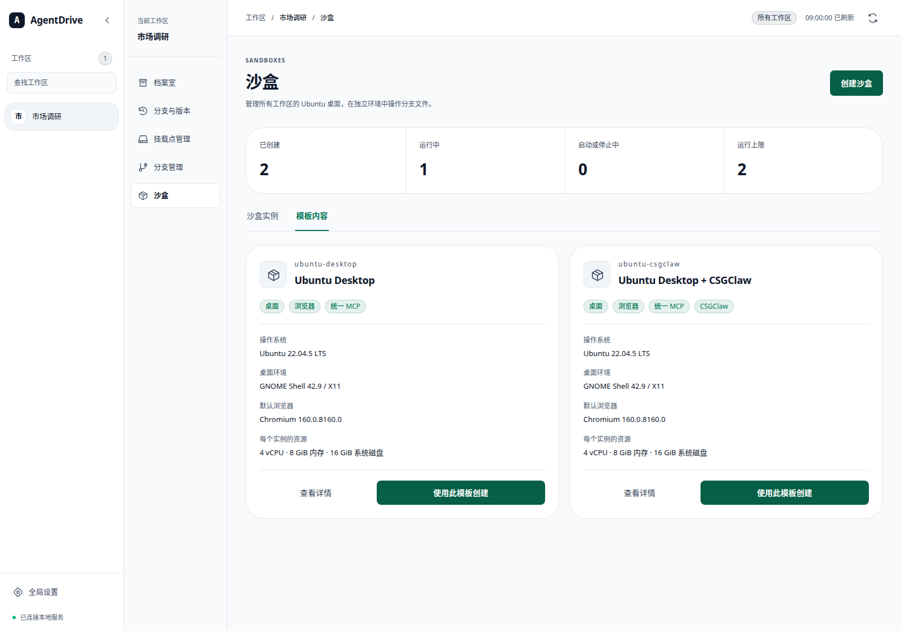

# AgentDrive

[English](README.md) | [简体中文](README.zh-CN.md)

**共享资料，接力工作。**

AgentDrive 给人和 Agent 一个可以持续使用的项目空间。Agent 在本地目录中读取资料、生成文档和修改代码；工作成果可以保存到远端，让另一台机器上的 Agent 接着完成任务。分支保留不同任务的工作内容，版本记录每次成果的变化。

你可以继续使用熟悉的 Agent、编辑器和终端，通过 MCP 让 Agent 管理资料的保存、同步、分支与交接。人在浏览器的 **档案室** 中直接查看各个分支的文档和图片。配置 Linux 运行环境后，每个分支还可以拥有 Ubuntu 桌面 Sandbox，共用桌面中的浏览器，并选择预装 CSGClaw 助手的模板。

> 当前为开发预览，尚未发布首个正式版本。产品名称暂为 AgentDrive。



*演示项目：市场调研。在 `/reports/交接` 中阅读 Agent 交接说明，查看本地保存与远端确认状态。*

## 围绕项目持续工作

| 使用场景 | AgentDrive 帮你完成的事情 |
| --- | --- |
| 本地工作，远程保存 | Agent 像使用普通目录一样工作，成果保存在本机，并通过配置的 S3 / RustFS 或 OpenCSG Codes 同步到远端。 |
| 异地 Agent 接手 | 把任务说明、输入资料、阶段成果与下一步一起保存；目标机器拉取后继续处理。 |
| 多个 Agent 并行尝试 | 从同一份资料创建分支，各自完成分析或实现，检查差异后合并成果。 |
| 人随时检查进展 | 在档案室选择项目和分支，阅读文档和预览图片；进入分支与版本查看来源、历史和修改内容。 |
| 为 Agent 提供桌面 | 启动分支 Sandbox，连接统一 MCP，让 Agent 使用 Chromium 和桌面应用处理当前分支文件。 |

## 使用方式

### 1. 在本地接入项目，让 Agent 开始工作

按照[安装与启动](docs/installation.zh-CN.md)运行 AgentDrive，并将它连接到支持 MCP 的 Agent 客户端。已有本地目录可以导入工作区并继续使用原路径；转换目录前暂停写入，转换完成后重启 Agent。

从空项目开始时，点击左侧 **创建工作区**，填写名称。AgentDrive 会创建工作区及默认的 `main` 分支，并打开档案室。之后可以在挂载点管理中挂载本机目录，或为分支创建 Sandbox。



可以直接告诉 Agent：

> 将这个项目接入 AgentDrive。保留原目录中的资料，为本次任务创建一个工作分支，并告诉我工作目录和分支名称。

Agent 通过 MCP 创建、挂载或转换工作区，随后继续使用普通文件工具读写目录。文件修改会自动保存；需要明确记录一个阶段时，让 Agent 保存版本，并填写这次完成了什么。

### 2. 将本地成果同步到远端

创建工作区时可以选择存储。已有工作区可在 Dashboard 的 **设置 → 存储设置** 中选择工作区，再选择仅本地、兼容 S3 的对象存储（包括 OSS、RustFS）或 OpenCSG Codes。使用已启用 XNet 的 Codes 仓库时，可以勾选 XNet，让 OpenCSG 按仓库规则处理大文件。协作机器为同一工作区配置相同的目标，各自保留独立的本地配置和数据目录。[连接说明](docs/configuration.zh-CN.md)

> 将当前分支的成果保存到远端。确认远端保存成功后，告诉我 workspace ID、分支、版本以及交接说明的位置。

Agent 可以通过 `mount_save` 请求远端保存，并通过操作结果检查 `remote_confirmed`。等待超时后继续查询同一个操作，直到得到确认。**本机已保存与远端已保存分别展示**；档案室中的远端状态来自最近一次确认。

### 3. 让另一台机器上的 Agent 接着工作

在项目中保留一份 `HANDOFF.md`，写明任务目标、已完成事项、关键文件、验证方式和下一步。将这份说明与成果一起保存到远端。

将 workspace ID、源分支或版本、交接说明路径交给目标 Agent：

> 拉取这个项目最新确认的远端资料，读取 HANDOFF.md，从指定分支的成果创建我的工作分支，挂载到本机目录，再继续下一步任务。

目标 Agent 使用 `sync` 拉取，再从指定来源创建分支并挂载。若要继续写入**同一个分支**，原机器需要停止写入并释放挂载，通过 `ownership_transfer` 将写入权限交给目标 location；目标机器拉取确认后再接手。[交接与恢复步骤](docs/operations.zh-CN.md)

交接材料包括文件、版本和分支信息。Agent 的任务说明可以作为文件一起传递；运行中的进程、聊天记录和客户端凭据由各自的 Agent 客户端管理。

### 4. 在档案室查看成果，在版本历史中检查变化

打开 Dashboard，选择项目，进入 **档案室**：

- 单击分支即可查看当前目录，右侧自动展示文件内容。
- Markdown 支持阅读和源码两种视图；PNG、JPEG、GIF、WebP、BMP、AVIF 和 ICO 图片支持预览与原图下载，预览上限为 20 MiB。文本可以分段阅读，其他二进制内容显示十六进制。
- 目录以 `/a/b/c` 展示，点击任一级即可跳转；支持筛选当前目录和显示隐藏文件，复制地址后可回到相同的项目、分支和目录。
- 本地进度、远端确认与目录使用情况分别展示。浏览分支时，Agent 使用的挂载目录保持原来的分支。
- 文件范围是本机已知的当前内容，包含未保存或未提交修改；查看其他机器的新成果前，让 Agent 拉取远端更新。



进入 **分支与版本**，可以查看 `main`、本机分支和其他 location 已发布的分支，连接点表示创建分支时使用的准确版本。页面每 2 秒刷新远端分支信息；远端连接失败时保留上次同步的关系并提示错误。本机默认分支和挂载数量独立标记。点击其他节点的分支可以查看版本历史，双击可以打开最近保存的版本。



*同一个演示项目的分支与版本页面。双击版本可以查看说明、修改文件和文本差异。*

### 5. 管理挂载点和分支

进入 **挂载点管理**（`/mounts`），选择分支、本机目录和访问方式来创建挂载点，也可以保存目录内容或卸载。页面中的 **分支与挂载关系** 支持搜索名称、目录、使用者和短 ID，并按分支、写入所属 location、本机挂载情况及历史记录筛选。筛选条件保存在页面地址中，可以复制地址或刷新页面继续查看。

进入 **分支管理**（`/branches`），选择来源分支和来源内容，填写名称即可创建分支。本机分支可以使用当前工作内容，也可以选择已保存版本；其他 location 的分支使用已保存版本。创建之后可以切换使用、挂载到本机目录或查看版本历史。

操作进度分别显示本机保存、远端确认和挂载状态。请求中断后可以检查结果或重试，页面使用原来的 `request_id` 恢复操作。





### 6. 为分支启动桌面和助手

完成 [Sandbox 运行环境配置](docs/sandbox.md)后，进入 **沙盒**（`/sandboxes`）页面，或点击分支旁的 **Sandbox** 按钮。选择具有本机写入权限的分支和模板，创建并启动实例。沙盒页面只展示当前工作区的实例，支持按照状态和分支名称筛选。模板由所有工作区共用，运行实例的数量上限由整台机器共用。

- **Ubuntu Desktop** 预装 GNOME、Chromium、中文和表情字体、终端、文件管理器及图片查看器。
- **Ubuntu Desktop + CSGClaw** 增加 CSGClaw Web UI 与 Agent。点击 **打开助手**，即可通过 AgentDrive 直接访问 Web UI，无需登录 VNC。在 CSGClaw 中配置模型账号后，通过聊天操作文件与浏览器。
- 当前分支自动挂载到 `/workspace`，浏览器下载文件保存到 `/workspace/Downloads`。实例始终使用创建时绑定的分支。
- **详情与 MCP** 弹窗展示启动步骤、代理设置及可以复制的统一 MCP 配置。computer-use-linux 与 Playwright MCP 共用桌面中的 Chromium。此配置提供桌面与浏览器工具；下文的 AgentDrive MCP 用于管理项目数据。
- 停止实例会释放运行资源并保留系统磁盘。删除已停止的实例会清除该系统磁盘，分支文件和版本历史继续保留。更新模板后，新建实例使用新模板。





*截图使用演示数据，由当前 Dashboard 页面生成。模板详情通过弹窗展示，查看详情和创建按钮并列。*

桌面运行环境需要 Linux x86_64、FUSE、可用的 KVM 或 PVM 设备及对应的 guest 内核。AgentDrive 在启动时检测宿主机后端，并选择已经配置的匹配内核。默认每个实例使用 4 vCPU、8 GiB 内存和 16 GiB 按需分配的系统磁盘。Docker 用于构建模板，实例由 worker 和仓库内的 hypervisor 运行。构建步骤、网络、内核配置和 MCP 连接条件见 [Sandbox 使用说明](docs/sandbox.md)。

## 方便 Agent 操控

在支持 stdio MCP 的客户端中添加下面的配置，将示例路径替换为本机绝对路径：

```json
{
  "mcpServers": {
    "agentdrive": {
      "command": "/absolute/path/agentdrive/target/debug/agentdrive",
      "args": ["mcp"],
      "env": {
        "AGENTDRIVE_ENDPOINT": "http://127.0.0.1:7421/mcp"
      }
    }
  }
}
```

保持 AgentDrive 服务运行。Agent 可以查询工具说明，再完成创建工作区、分支、保存、同步与交接。支持 Streamable HTTP 的客户端也可以连接 `http://127.0.0.1:7421/mcp`，无需配置本机访问令牌；CLI 适合终端操作和脚本，ACP / Codex app-server 可连接工作目录与任务结束保存。[Agent 集成](docs/integrations.zh-CN.md) · [MCP 工具](docs/mcp.zh-CN.md) · [CLI](docs/cli.zh-CN.md)

切换分支可以通过一次 `branch_switch` 调用完成。目录被进程占用时，按照返回提示关闭相关进程或重启 Agent，再重试同一个操作。

## 开始使用

目前从源码构建，支持 Linux、macOS 和 Windows。原生目录挂载分别需要 Linux FUSE、macOS 内置 NFS 或 Windows WinFsp。[安装、平台依赖与启动命令](docs/installation.zh-CN.md)

- [配置远程存储](docs/configuration.zh-CN.md)：本地模式、S3、RustFS、OpenCSG Codes 与多台机器配置。
- [操作与恢复](docs/operations.zh-CN.md)：远端确认、交接、分支合并及异常恢复。
- [文档目录](docs/README.zh-CN.md)：完整使用参考与开发文档。

AgentDrive 使用 Apache-2.0 许可证。包含的组件保留各自许可证，包括 WinFsp Rust wrapper（MIT）及 `sandbox/hypervisor` 中源自 CubeSandbox 的 hypervisor。模板软件保留各自许可条款与来源记录。
